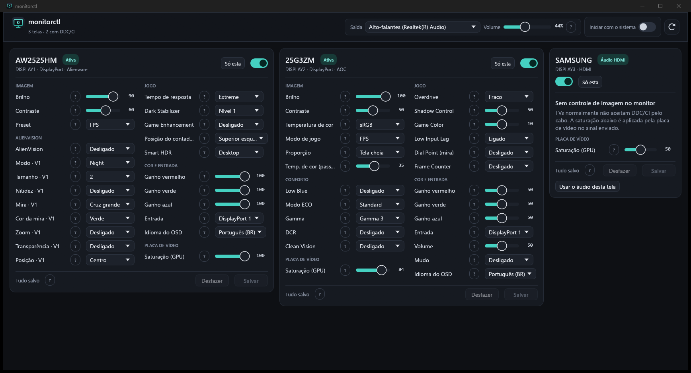

# monitorctl

[](https://github.com/edsuuu/monitorctl/actions/workflows/ci.yml)

Controle de monitores pelo PC, sem o software do fabricante. Windows e Linux, um binário só (Rust).



## Instalar

Baixe da página de [Releases](https://github.com/edsuuu/monitorctl/releases/latest):

- **Windows**: `monitorctl-setup-x64.exe`, um instalador por usuário (não pede administrador) que cria atalhos no Menu Iniciar e na área de trabalho. O `monitorctl-windows-x64.exe` é o mesmo programa, para rodar sem instalar.
- **Linux**: `monitorctl-linux-x64` (`chmod +x monitorctl-linux-x64`). Veja os [requisitos](#linux).

## Recursos

- **Imagem via DDC/CI**: brilho, contraste, saturação, ganhos RGB, preset de cor, entrada, volume, idioma do OSD…
- **Saturação pela placa de vídeo** (NVIDIA "Vibração digital", por saída): aplicada no sinal enviado, então funciona até na TV, que não aceita DDC/CI. O valor salvo é reaplicado ao abrir o app, porque o driver esquece no reboot (use junto com "Iniciar com o sistema"). Windows: NVAPI; Linux: `nvidia-settings` (driver proprietário, X11).
- **Recursos proprietários**, mapeados por engenharia reversa dos apps oficiais:
  - **Alienware (AWCC)**: preset (FPS, MOBA, RPG, SPORTS…), tempo de resposta, Dark Stabilizer, contador de FPS/timer e posição, Smart HDR, AlienVision (modo, mira, cor, zoom…).
  - **AOC (G-Menu)**: Overdrive, Shadow Control, Game Color, Low Input Lag, Dial Point (mira), Frame Counter, Low Blue, ECO, Gamma, DCR, DCB, modo de jogo.
- **Telas tipo Win+P, mas por saída**: liga e desliga cada tela (ex.: deixar a TV no HDMI plugada e desligada), "só esta" ou "todas".
- **Perfis de telas**: salve as telas ligadas agora com um nome (ex.: "Só TV", "Monitores") e aplique com um clique, pela CLI (`monitorctl perfil "só tv"`) ou pelo MCP. Ficam em `perfis.txt`, pelo nome das telas.
- **Taxa de atualização (Hz)** por tela, entre as que a placa de vídeo oferece na resolução atual (Windows; Linux no X11 via `xrandr`).
- **Áudio manual**: ligar/desligar telas nunca troca a saída de áudio; você escolhe a saída (ex.: a TV) na barra de áudio ou no card da tela.
- **Trava de segurança**: nunca deixa zero telas ativas. Na interface, se a mudança desligar todas as telas que você estava vendo, ela é revertida em 15s, a menos que você clique em "Manter".
- **Salvar / Desfazer**: toda mudança feita na interface vale na hora, mas só fica gravada ao clicar em **Salvar** (que também manda o comando DDC/CI `0x0C`, "Save Current Settings"). **Desfazer** volta aos valores salvos, e fechar o app sem salvar também desfaz. Se o app cair, as pendências ficam em `pendente-<monitor>.txt` e reaparecem como "não salvas" na próxima abertura.
- **Ajuda em cada opção**: passe o mouse no **?** ao lado de cada controle.
- **Iniciar com o sistema**: opção no cabeçalho. Abre minimizado (`--min`). Windows: `HKCU\Software\Microsoft\Windows\CurrentVersion\Run`; Linux: `~/.config/autostart/monitorctl.desktop`.
- **Log** de toda operação e erro, inclusive crash (panic com backtrace e exceção nativa no Windows).

| Monitor | Testado | Caminho |
|---|---|---|
| Alienware AW2525HM | ✅ leitura e escrita | dxva2 (Windows) / i2c-dev (Linux) |
| AOC 25G3ZM | ✅ leitura e escrita | padrão: dxva2; `F8 E1 xx`: NVAPI I2C (Windows) / i2c-dev (Linux) |
| Qualquer monitor DDC/CI | controles MCCS padrão | descobertos pela capabilities string |

## Uso

Sem argumentos, abre a interface. Com argumentos, funciona como CLI (bom para atalhos):

```
monitorctl list                    telas, monitores DDC/CI e saídas de áudio
monitorctl on|off|only TELA..      liga/desliga telas (TELA = parte do nome, ex: samsung)
monitorctl all                     liga todas as telas conectadas
monitorctl caps MONITOR            capabilities DDC/CI + todos os controles e valores
monitorctl get MONITOR CONTROLE    CONTROLE = nome (brilho, preset...) ou código: 10 | AOC f8e151
monitorctl set MONITOR CONTROLE V  V = número ou nome da opção
monitorctl sat TELA [0-100]        saturação pela placa de vídeo (NVIDIA), funciona na TV
monitorctl hz TELA [HZ]            taxa de atualização: lista as opções ou troca
monitorctl audio SAIDA             define a saída de áudio padrão
monitorctl mcp                     servidor MCP (stdio) para o Claude
```

Exemplos:

```
monitorctl off samsung          # desliga a TV
monitorctl on samsung           # liga a TV (o áudio não muda)
monitorctl audio samsung        # manda o áudio para a TV
monitorctl only aw              # só o Alienware
monitorctl all
monitorctl set aw brilho 30
monitorctl set aw preset fps
monitorctl set 25g3 overdrive médio
monitorctl sat samsung 70       # TV com cores mais vivas
monitorctl hz aw 240            # Alienware a 240 Hz
```

Mudanças pela CLI/MCP gravam direto no monitor; o Salvar/Desfazer é da interface.

## MCP (pedir para o Claude)

`monitorctl mcp` é um servidor [MCP](https://modelcontextprotocol.io) por stdio; a interface não precisa estar aberta. Com ele você pode pedir, por exemplo: "desliga a TV", "deixa só o Alienware ligado", "baixa o brilho dos dois monitores para 20", "coloca o AOC no modo FPS", "deixa a TV mais saturada", "coloca o AOC em 144 Hz", "manda o som para a TV".

Ferramentas: `listar`, `telas`, `controles`, `ler`, `ajustar`, `saturacao_gpu`, `taxa_atualizacao`, `audio`. Cada uma é um comando da CLI acima, com o mesmo log.

Claude Code (caminho do instalador):

```
claude mcp add --scope user monitorctl -- "%LOCALAPPDATA%\Programs\monitorctl\monitorctl.exe" mcp
```

Claude Desktop (`%APPDATA%\Claude\claude_desktop_config.json`):

```json
{ "mcpServers": { "monitorctl": { "command": "C:\\Users\\VOCE\\AppData\\Local\\Programs\\monitorctl\\monitorctl.exe", "args": ["mcp"] } } }
```

## Build

```
cargo build --release       # target/release/monitorctl(.exe); builds locais ficam em builds/ (fora do git)
cargo test
```

Instalador do Windows ([Inno Setup 6](https://jrsoftware.org/isinfo.php)): veja o comando no topo de [`installer/monitorctl.iss`](installer/monitorctl.iss).

### CI/CD

- [`ci.yml`](.github/workflows/ci.yml): testes e build release no Windows e no Linux a cada push e pull request.
- [`release.yml`](.github/workflows/release.yml): ao subir uma tag `v*` (ex.: `git tag v0.1.0 && git push origin v0.1.0`), gera o instalador e os binários e publica uma Release. A versão vem do `Cargo.toml`. Rodando manualmente ("Run workflow"), só gera os arquivos como artefatos.

### Linux

- **DDC/CI**: `sudo modprobe i2c-dev` e o usuário no grupo `i2c` (ou uma regra udev). Barramentos SMBus nunca são tocados.
- **Telas**:
  - X11: `xrandr`.
  - Wayland KDE: `kscreen-doctor`.
  - wlroots (Sway, Hyprland): `wlr-randr`.
  - GNOME Wayland ainda não é suportado (`gdctl` do GNOME 48+ seria o caminho).
- **Áudio**: `pactl` (PulseAudio ou PipeWire).

## Log

- Windows: `%APPDATA%\monitorctl\monitorctl.log`
- Linux: `~/.config/monitorctl/monitorctl.log`

O arquivo gira em 1 MB e guarda:
- toda ação: telas, áudio, escrita VCP;
- todo erro tratado, inclusive bytes brutos das respostas I2C;
- panics com backtrace;
- crashes nativos no Windows.

## Como funciona

- **Windows**:
  - Telas: CCD API (`QueryDisplayConfig` / `SetDisplayConfig`).
  - DDC/CI: dxva2.
  - Opcodes AOC de 3 bytes: NVAPI I2C, porque o dxva2 não transporta.
  - Áudio padrão: `IPolicyConfig`.
- **Linux**:
  - DDC/CI: ioctl direto em `/dev/i2c-*`, com EDID lido em 0x50.
- **Protocolos proprietários**:
  - **Dell `0xF4`**: multiplexado. Para ler, grava o seletor `categoria<<4|F`, espera 200 ms e lê. O preset é gravado em `DC/14/F0` e lido em `E2`. AlienVision usa bitfields em `EC/ED`.
  - **AOC `F8 E1 xx`**: a máscara de suporte fica em `F8 E1 00`. A resposta ecoa o opcode, o que permite descartar buffers velhos.
